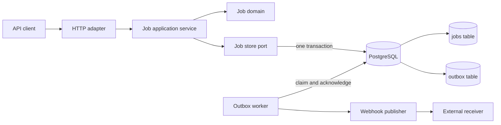

# Go backend API template

This repository demonstrates a small backend service that accepts retried job-creation requests without creating duplicate records or losing the matching event.<br>
It keeps the job and event durable in one PostgreSQL transaction, then delivers events to a webhook with retryable, at-least-once semantics.

It is a runnable Go template with one example bounded context, explicit application ports, PostgreSQL persistence, HTTP endpoints, tests, and documented quality gates.

## Architecture



The HTTP adapter handles validation and the bootstrap API key. The application service owns use-case rules; the PostgreSQL adapter implements the store port. The worker and publisher are started only when `EVENT_WEBHOOK_URL` is configured.

## Run locally

Requires Go 1.27.2+, Docker Compose and `psql` (or the Compose fallback used by `make migrate`). From the repository root, prepare PostgreSQL and apply the schema:

```sh
cp .env.example .env && docker compose up -d db && make migrate
```

Then start the API in one command:

```sh
make run
```

`make run` loads `.env` and starts the API on `localhost:8080`. In another terminal, create and read a job:

```sh
set -a; . ./.env; set +a
IDEMPOTENCY_KEY="demo-$(date +%s)-$$"
curl -i -H "Authorization: Bearer $API_KEY" -H "Idempotency-Key: $IDEMPOTENCY_KEY" \
  -H 'Content-Type: application/json' -d '{"name":"example"}' \
  http://localhost:8080/v1/jobs
curl -i http://localhost:8080/live
curl -i http://localhost:8080/ready
```

The first create returns `201`; a retry with the same key and normalized name returns `200` with the same job. A request with the same key and a different name returns `409`. The example API key is only a local bootstrap guard, not product authentication.

## Design decisions and trade-offs

- **Idempotent create:** the database uniquely constrains the idempotency key and stores a hash of the normalized name. A repeat with the same name returns the existing job; a repeat with a different name conflicts. Keys are required and limited to 1–128 bytes after trimming. This protects retries for this create operation; it is not a general idempotency framework.
- **Transactional outbox:** the job row and versioned `JobCreated.v1` event are committed together in PostgreSQL. The worker publishes after commit and marks an event delivered only after a 2xx response. This avoids losing the event between the business write and event recording, while keeping PostgreSQL as the single durable store.
- **At-least-once delivery:** a crash after the receiver accepts an event but before the database records delivery can cause a duplicate. The stable `X-Event-Id` lets the receiver deduplicate. Failed publishes remain pending with increasing retry delays; events are not automatically discarded.
- **Polling and concurrency:** the worker polls PostgreSQL and selects pending rows with `FOR UPDATE SKIP LOCKED`. This lets multiple worker processes claim different rows. Each process handles one event at a time, holds its database transaction while publishing, and can retry after a failure. This is intentionally simpler than adding a broker; it also means throughput and lock duration have not been benchmarked here.
- **Consistency and reads:** the API reads the job from the same PostgreSQL store used for writes. The outbox guarantees atomic persistence of a job and its event, not exactly-once delivery or immediate completion of a job. The sample job remains `pending`; there is no job processor.
- **Health checks:** `/live` checks that the HTTP process responds. `/ready` checks database access and whether any undelivered event is older than the configured lag threshold.

## Tests and quality gates

Run the Go unit and HTTP tests with the race detector:

```sh
make test
```

Run the full repository gate with Go, Node.js 24+, Docker, and a separate PostgreSQL test database available. Set `TEST_DATABASE_URL` (see `.env.example`); `DATABASE_URL` is used for local database access and must not be the same database as the test URL.

```sh
make check
```

The full gate includes formatting, architecture and spec checks, secret scans, tests and coverage, MCP checks, dependency verification, vulnerability scanning, Git history scanning, and PostgreSQL integration tests. It reports which checks actually ran; the results depend on the local environment.

## What this demonstrates

This example shows how I structure a Go backend around explicit use cases and ports, test domain and HTTP behavior, protect a write path against retries, and reason about durable event delivery and failure recovery. It also shows a spec-driven workflow with operational and security constraints documented alongside the code.

The repository is a focused template, not evidence of a production deployment or measured scale. It does not include product-specific user authorization, rate limiting, a broker, a job execution engine, separate read storage, production observability, an SLO, or performance benchmarks. Before production, those requirements need their own specifications, implementations, and validation.

## Repository guide

- [`docs/INDEX.md`](docs/INDEX.md): documentation map.
- [`docs/ARCHITECTURE.md`](docs/ARCHITECTURE.md): dependency directions and example flow.
- [`docs/OPERATIONS.md`](docs/OPERATIONS.md) and [`docs/SECURITY.md`](docs/SECURITY.md): failure handling and security controls.
- [`docs/openapi.yaml`](docs/openapi.yaml): HTTP contract.
- [`specs/`](specs/): feature intent, plans, decisions, and validation records.
